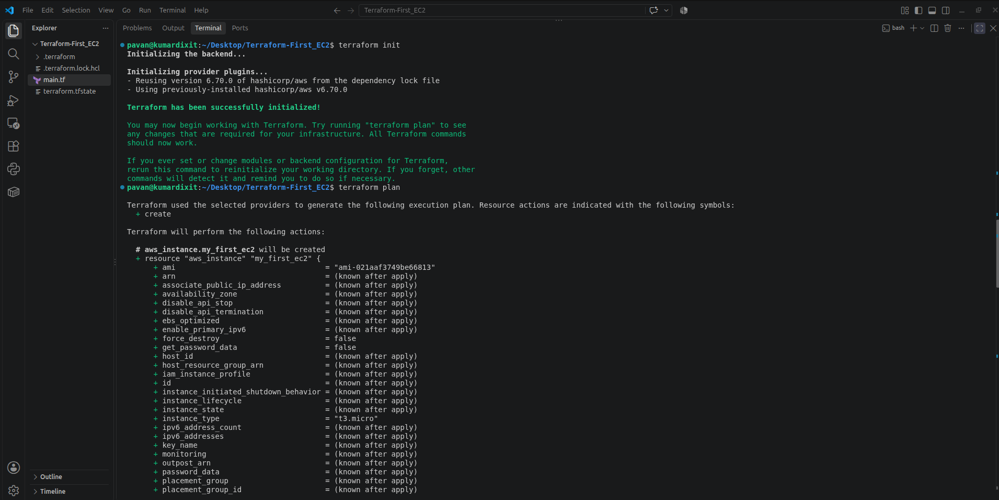
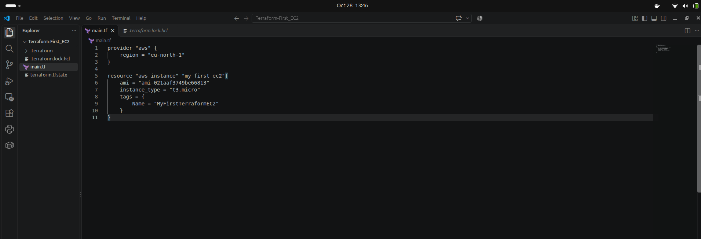
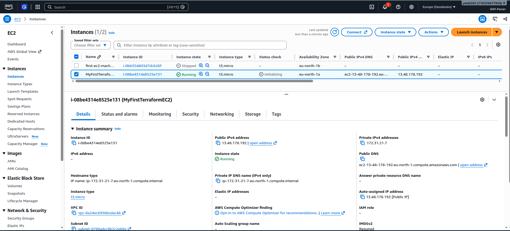

# Create an AWS EC2 Instance Using Terraform

This guide walks you through creating an Amazon EC2 instance in the AWS `eu-north-1` (Europe — Stockholm) Region using Terraform and Visual Studio Code.

## Prerequisites

Before you begin, make sure you have:

- An AWS account with permission to create EC2 instances.
- AWS credentials configured locally (for example, with `aws configure`).
- Terraform installed.
- Visual Studio Code installed.
- An AMI ID that is valid in the `eu-north-1` Region.

> **Important:** Replace `ami-image-id` with a real AMI ID for your selected operating system in `eu-north-1`. Replace `instance-name` with the name you want to assign to the instance. The example uses `t3.micro`; availability and Free Tier eligibility depend on your account, region, and current AWS terms.

## 1. Create a Project Directory

Open the Ubuntu terminal and run the following commands to create a directory for the Terraform configuration:

```bash
mkdir terraform-ec2
cd terraform-ec2
```

- `mkdir terraform-ec2` creates the project directory.
- `cd terraform-ec2` moves into the directory.

## 2. Open the Project in Visual Studio Code

Run this command from inside the project directory:

```bash
code .
```

The `.` means the current directory. Visual Studio Code will open the `terraform-ec2` project.

## 3. Create the `main.tf` File

In Visual Studio Code, create a new file named **`main.tf`** in the project directory.

Add the following Terraform configuration:

```hcl
provider "aws" {
  region = "eu-north-1"
}

resource "aws_instance" "my_first_ec2" {
  ami           = "ami-image-id"
  instance_type = "t3.micro"

  tags = {
    Name = "instance-name"
  }
}
```

Save the file.

### Configuration explained

- `provider "aws"` configures Terraform to use the AWS provider.
- `region = "eu-north-1"` selects the Europe (Stockholm) Region.
- `resource "aws_instance" "my_first_ec2"` defines an EC2 instance resource managed by Terraform.
- `ami` specifies the Amazon Machine Image (AMI) used to launch the instance.
- `instance_type = "t3.micro"` selects the instance type.
- `tags` assigns a readable name to the instance.

> **Before continuing:** An AMI ID is Region-specific. Use a valid AMI ID available in `eu-north-1`. The text `ami-image-id` is a placeholder and will not work as written.

## 4. Initialize Terraform

In the VS Code terminal, ensure you are in the `terraform-ec2` directory and run:

```bash
terraform init
```

Terraform downloads the required provider plugins and initializes the working directory.

## 5. Validate the Configuration (Recommended)

Run:

```bash
terraform validate
```

This checks the configuration for syntax and internal consistency. It does not confirm that the AMI exists or that AWS permissions are sufficient.

## 6. Review the Execution Plan

Run:

```bash
terraform plan
```

Review the proposed changes. Terraform should show that it plans to create one EC2 instance. If you see errors, check the AMI ID, AWS credentials, Region, and permissions before proceeding.

## 7. Create the EC2 Instance

When the plan looks correct, run:

```bash
terraform apply
```

Terraform displays a plan and asks for confirmation. Type:

```text
yes
```

and press **Enter** to approve the changes.

Wait for Terraform to finish. A successful run should report that one resource was added.

## 8. Verify the Instance in the AWS Console

1. Sign in to the [AWS Management Console](https://console.aws.amazon.com/).
2. Open **EC2**.
3. Make sure the selected Region is **Europe (Stockholm) — `eu-north-1`**.
4. Select **Instances** from the navigation panel.
5. Find the instance with the name specified in the `Name` tag (`instance-name` in the example).

Your EC2 instance should now appear in the Instances list. The provided screenshot `Images/EC2-Instace.png` can be used as a visual reference.

## 9. Project Structure

After creating the configuration and adding your screenshots, the directory can look like this:

```text
terraform-ec2/
├── Images/
│   ├── command-run.png
│   ├── EC2-Instace.png
│   └── main-file-code.png
└── main.tf
```

## 10. Screenshots

### Step 1: Create the Project and Run Terraform Commands



### Step 2: Terraform Configuration in `main.tf`



### Step 3: Verify the EC2 Instance in AWS



## 11. Clean Up Resources

**Important:** EC2 instances can incur charges while running. When you no longer need this practice instance, you can remove the resources managed by this Terraform configuration.

From the project directory, run:

```bash
terraform destroy
```

Review the proposed deletions, then type `yes` when prompted to confirm. Do not run this command if you want to keep the instance.

## Troubleshooting

- **`InvalidAMIID.NotFound`:** The AMI ID may be incorrect or unavailable in `eu-north-1`. Find a valid AMI for the selected Region.
- **AWS credentials or access denied errors:** Check that your credentials are configured and have the required EC2 permissions.
- **`terraform: command not found`:** Install Terraform and open a new terminal.
- **Instance not visible in the console:** Confirm that the AWS Console is set to `eu-north-1` and refresh the Instances page.

---

**Result:** You have used Terraform to define, plan, and create an AWS EC2 instance, then verified it in the AWS Management Console.
